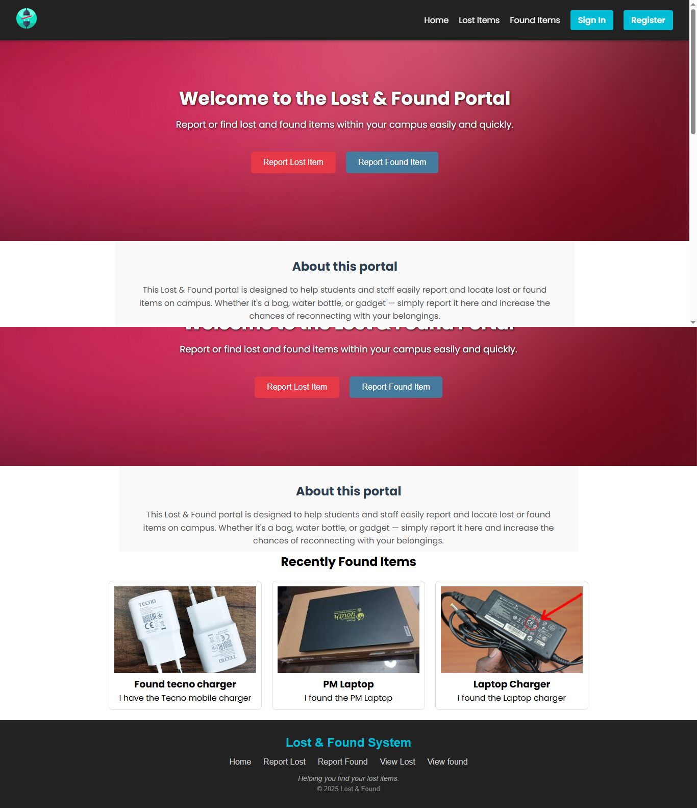
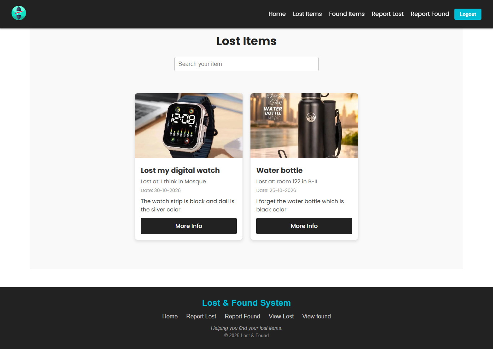
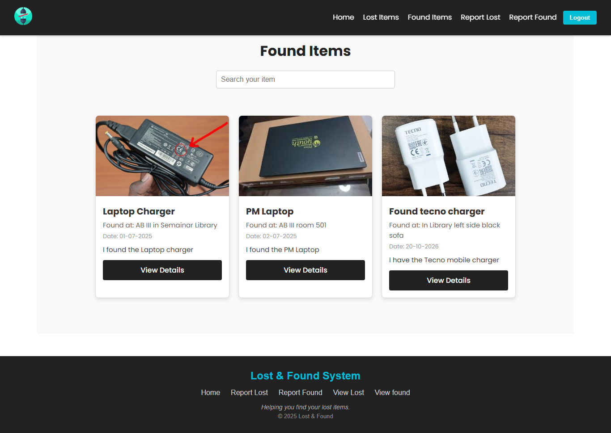
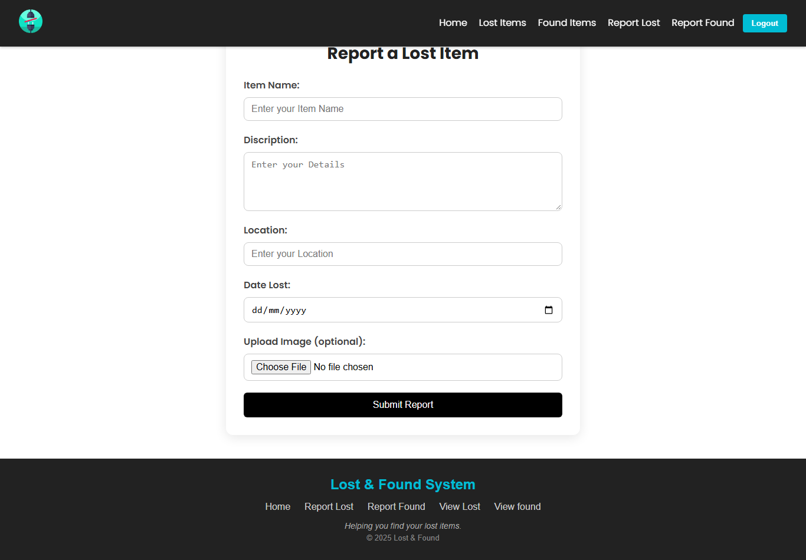
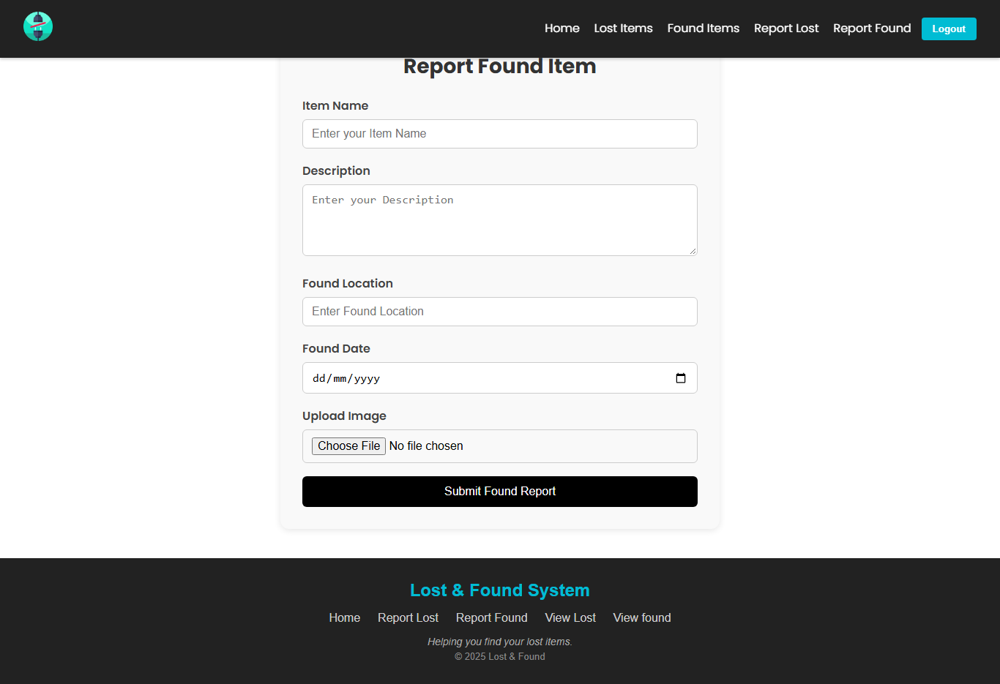
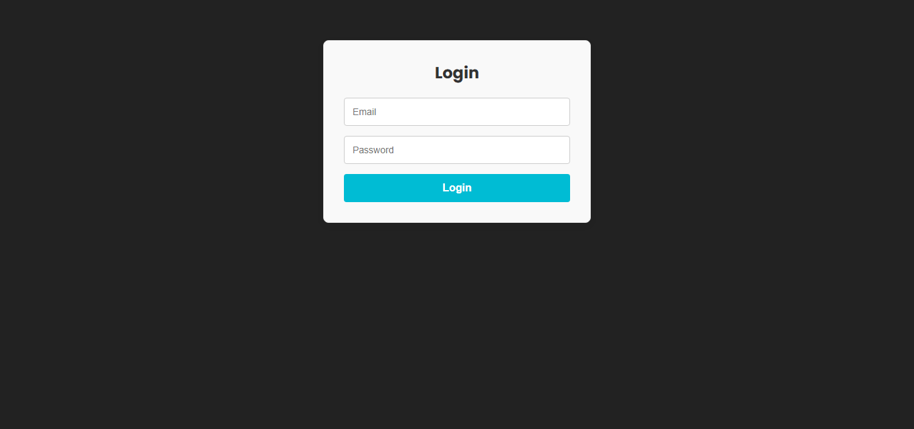
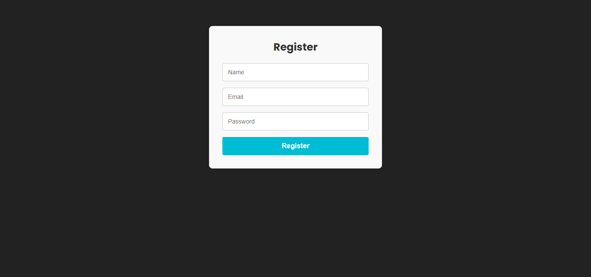
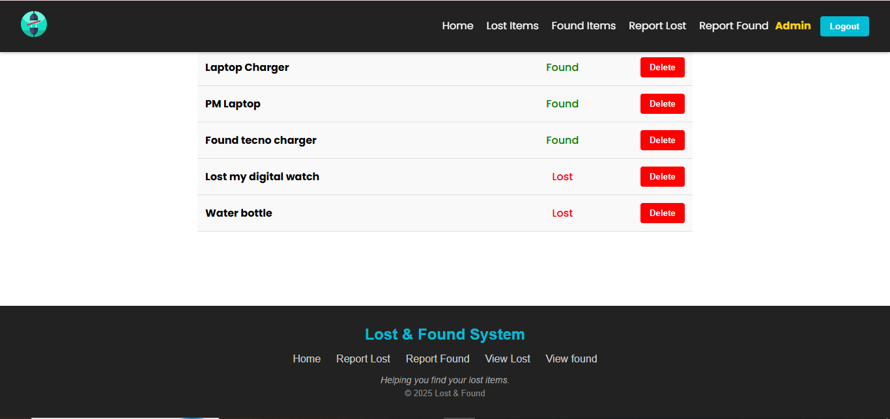

# 🔍 Lost & Found Portal

A full-stack web application that helps students and staff **report, search and recover lost and found items** within a campus. Users can post lost or found items with photos, browse recent reports, and admins can manage the platform.



---

## ✨ Features

- 🔐 **User authentication**: sign up and log in securely (passwords hashed with bcrypt)
- 📢 **Report Lost Items**: add a title, description and photo of something you lost
- 📦 **Report Found Items**: let others know you found something
- 🗂️ **Browse Items**: separate pages for all Lost Items and Found Items
- 🏠 **Recent Items on Home**: latest lost and found reports at a glance
- 🖼️ **Image Upload**: attach pictures to every report
- 🛡️ **Admin Role**: admin users get an Admin badge and can manage items and users
- 📱 **Responsive Design**: works on desktop and mobile

---

## 📸 Screenshots

### Home Page


### Lost Items


### Found Items


### Report a Lost Item


### Report a Found Item


### Login / Register
| Login | Register |
|-------|----------|
|  |  |

### Admin Panel



---

## 🛠️ Tech Stack

| Layer      | Technologies |
|------------|--------------|
| Frontend   | React 19, Vite 6, React Router 7, Axios, SweetAlert2, React Icons |
| Backend    | Node.js, Express 5, Mongoose |
| Database   | MongoDB Atlas |
| Auth       | bcrypt password hashing |
| Deployment | Vercel |

---

## 📁 Project Structure

```
Lost_and_Found-main
├── Backend
│   ├── api/            # Vercel serverless entry
│   ├── middleware/     # Auth / upload middleware
│   ├── models/         # Mongoose models (User, Item)
│   ├── routes/         # authRoutes, itemRoutes, adminRoutes
│   ├── uploads/        # Uploaded item images
│   ├── server.js       # Express server
│   └── .env            # Environment variables (not committed)
├── public/             # Static assets (logo, favicon)
├── src/
│   ├── api/
│   ├── components/     # Navbar, Footer, etc.
│   ├── context/        # AuthContext
│   ├── pages/          # Home, LostItems, FoundItems, Login, Signup...
│   ├── App.jsx
│   └── main.jsx
├── screenshots/        # README screenshots
├── index.html
├── vite.config.js
└── package.json
```

---

## 🚀 Getting Started

### Prerequisites

- [Node.js](https://nodejs.org/) (v18 or higher)
- A [MongoDB Atlas](https://www.mongodb.com/atlas) account (free tier works)

### 1. Clone the repository

```bash
git clone https://github.com/<your-username>/Lost_and_Found.git
cd Lost_and_Found
```

### 2. Install dependencies

```bash
# Frontend (root folder)
npm install

# Backend
cd Backend
npm install
cd ..
```

### 3. Set up environment variables

Create a `.env` file inside the `Backend` folder:

```env
MONGO_URI=your_mongodb_connection_string
PORT=5000
```

> ⚠️ Never commit your `.env` file. Make sure it is listed in `.gitignore`.

### 4. Allow your IP in MongoDB Atlas

In Atlas go to **Security → Network Access → Add IP Address** and add your current IP (or `0.0.0.0/0` for development only).

### 5. Run the app

Open **two terminals**.

**Terminal 1: Backend**
```bash
cd Backend
npm run dev
```
Backend runs on `http://localhost:5000`

**Terminal 2: Frontend**
```bash
npm run dev
```
Frontend runs on `http://localhost:5173`

The Vite dev server proxies `/api` and `/uploads` requests to the backend (see `vite.config.js`).

---

## 🔌 API Overview

| Route | Description |
|-------|-------------|
| `POST /api/auth/signup` | Register a new user |
| `POST /api/auth/login` | Log in |
| `/api/items/*` | Create and fetch lost / found items |
| `/api/admin/*` | Admin-only actions |
| `GET /uploads/<file>` | Serve uploaded images |

---

## 👑 Creating an Admin

New users are regular users by default. To make a user an admin:

1. Open **MongoDB Atlas → Browse Collections → users**
2. Edit the user document
3. Add the field `isAdmin` (Boolean) with value `true`
4. Log out and log in again

---

## ☁️ Deployment (Vercel)

The project includes a `vercel.json` that serves the Express API from `Backend/api/index.js` and the Vite build from `dist`.

Things to remember:

- Add `MONGO_URI` in the Vercel project **Environment Variables**
- In MongoDB Atlas allow access from `0.0.0.0/0` (Vercel IPs are not fixed)
- Vercel's filesystem is temporary, so **uploaded images will not persist**. For production, store images on a service like Cloudinary

---

## 🧰 Scripts

| Command | Description |
|---------|-------------|
| `npm run dev` | Start the Vite dev server |
| `npm run build` | Build the frontend for production |
| `npm run preview` | Preview the production build |
| `npm run lint` | Run ESLint |

---

## 🤝 Contributing

1. Fork the project
2. Create a feature branch: `git checkout -b feature/my-feature`
3. Commit your changes: `git commit -m "Add my feature"`
4. Push the branch: `git push origin feature/my-feature`
5. Open a Pull Request

---

## 👩‍💻 Author

**Shafique Bhutto**
